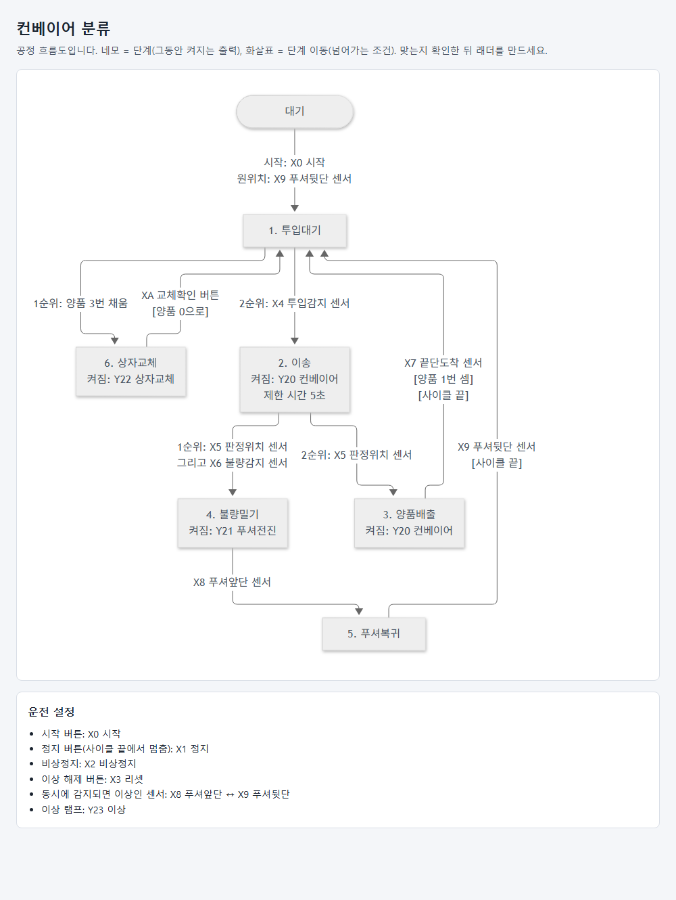
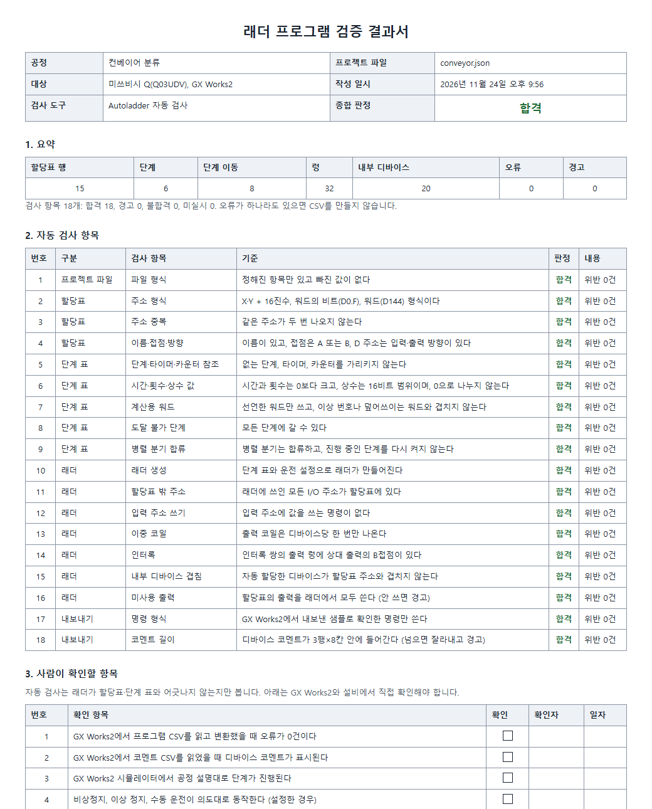

# Autoladder

공정 설명과 I/O 할당표로 미쓰비시 Q 시리즈(GX Works2)용 래더 프로그램을 만드는 도구입니다.
Claude Code와 대화하며 공정을 정리하면, Claude Code가 프로젝트 파일(JSON)을 쓰고 이 도구가 래더를 만들어 CSV로 내보냅니다.

- **LLM은 공정을 단계 표로 정리하는 데까지만 관여합니다.** 래더는 규칙 기반 코드가 만들기 때문에 같은 프로젝트 파일이면 결과가 항상 같습니다.
- **만든 래더를 스스로 검사합니다.** 할당표 밖 주소, 이중 코일, 인터록 누락 같은 오류가 있으면 CSV를 만들지 않습니다.
- **CSV 형식은 GX Works2에서 직접 내보낸 샘플로 확정했습니다.** 샘플과 바이트 단위로 같은지 테스트합니다.

## 쓰는 흐름

1. Claude Code와 할당표·공정을 이야기합니다. 빠진 값(타이머 시간, 넘어가는 조건)은 Claude Code가 임의로 채우지 않고 묻습니다.
2. Claude Code가 프로젝트 파일을 쓰고 검사합니다.
3. 공정 흐름도를 브라우저에 띄워 공정이 맞는지 확인합니다.
4. 래더를 만들어 `MAIN.csv`(프로그램)와 `COMMENT.csv`(디바이스 코멘트)로 내보냅니다.
5. GX Works2에서 CSV를 불러와 변환하고 시뮬레이터로 확인합니다.

### 공정 흐름도

단계는 네모, 단계 이동은 화살표와 조건으로 그립니다. 아래는 예시 공정 "컨베이어 분류"입니다.



### 검증 결과서

자동 검사 18개 항목의 기준과 판정(합격 / 경고 / 불합격 / 미실시), 그리고 사람이 GX Works2와 설비에서 확인할 항목을 문서 한 장으로 냅니다.



## 설치

Node.js 22 이상과 Claude Code가 필요합니다. 스킬 폴더 하나만 복사하면 됩니다.

```powershell
git clone https://github.com/woogijeong/Autoladder.git
Copy-Item Autoladder\skills\autoladder "$HOME\.claude\skills\autoladder" -Recurse
```

Claude Code를 새로 열고 "래더 만들어줘"라고 하면 스킬이 동작합니다. 도구는 라이브러리까지 한 파일(`cli.mjs`)로 묶여 스킬 폴더에 들어 있어 `npm install`이 필요 없습니다.

## 명령

Claude Code 없이 직접 실행할 수도 있습니다.

```
node skills/autoladder/cli.mjs check    <프로젝트.json>   검사만
node skills/autoladder/cli.mjs generate <프로젝트.json>   검사 후 MAIN.csv, COMMENT.csv 쓰기
node skills/autoladder/cli.mjs diagram  <프로젝트.json>   공정 흐름도(HTML)
node skills/autoladder/cli.mjs report   <프로젝트.json>   검증 결과서(HTML)
node skills/autoladder/cli.mjs tags     <할당표.xlsx|.csv> 할당표 파일을 태그 목록으로
```

예시 프로젝트 파일은 `skills/autoladder/examples/`에 있습니다(실린더 순차 왕복, 신호등, 두 실린더 동시 동작, 컨베이어 분류, MPS 라인). 형식은 `skills/autoladder/SKILL.md`에 정리했습니다.

## 만들 수 있는 것

- 공정 구조: 순차, 반복, 선택 분기, 병렬 분기·합류, 횟수 세기(카운터), 단계 타이머
- 운전 모드: 자동, 사이클 정지, 비상정지, 수동, 원점복귀, 이상 감지와 이상 번호 기록, 리셋
- 안전 관련: 인터록 쌍, B접점 입력, 센서 쌍 모순 감지, 단계 제한 시간
- 데이터: 16비트 워드의 사칙연산·대입, 비교 조건, 고정값 쓰기
- 주소: X·Y, 워드의 비트(`D0.F`), 워드(`D144`)
- 렁 설명을 GX Works2의 행 간 스테이트먼트로, 디바이스 이름을 코멘트로 함께 내보냄

## 생성 방식

단계 릴레이 방식입니다. 블록을 정해진 순서로 만듭니다.

1. 운전 상태
2. 단계 이동 조건 판정 (단계 릴레이를 바꾸지 않음)
3. 단계 갱신
4. 타이머·카운터·계산
5. 이상 감지
6. 비상정지·이상·수동 전환 시 모든 단계 해제
7. 원점복귀, 고정값 쓰기
8. 출력 (출력 1개당 렁 1개)

판정 블록과 갱신 블록을 나눠서 조건이 연속으로 참이어도 한 스캔에 한 단계만 진행합니다. 출력 코일은 마지막 블록에만 있어서 이중 코일이 구조적으로 생기지 않습니다.

## 확인한 것과 한계

- GX Works2(Q03UDV)에서 CSV를 불러와 변환되는 것, 실린더 순차 왕복과 신호등이 GX Works2 시뮬레이터에서 공정대로 도는 것을 직접 확인했습니다.
- MPS 라인 공정은 GX Simulator2와 MPS 디지털 트윈(PlcTwin)을 연결해, 금속 칩이 공급부터 창고 선반 적재까지, 비금속 칩이 배출까지 가는 것을 확인했습니다.
- 자동 검사의 "합격"은 래더가 할당표·단계 표와 어긋나지 않는다는 뜻입니다. 설비에서 의도대로 도는지는 시뮬레이터와 실기에서 사람이 확인해야 합니다.
- 실제 PLC에 써 본 적은 없습니다. 생성물은 초안이며 실기 투입 전 검토가 필요합니다.
- 32비트·실수 연산, 아날로그, 정전 후 단계 기억, 미쓰비시 Q + GX Works2 외의 기종은 지원하지 않습니다.
- 공정 흐름도는 Mermaid를 인터넷에서 불러와 그립니다.

## 개발

```
npm install
npm test               # 테스트. samples/ 에 예시 공정 CSV도 다시 쓴다
npm run typecheck
npm run install:skill  # cli.mjs 빌드 후 스킬 폴더를 ~/.claude/skills/autoladder 로 복사
```

| 위치 | 내용 |
|---|---|
| `src/core/` | 순수 TypeScript. 단계 표 → 래더 생성, 검증, CSV 내보내기, 할당표 읽기, 프로젝트 파일 형식, 흐름도, 결과서 |
| `src/cli/` | 명령줄 도구, xlsx·csv 파일 읽기 |
| `skills/autoladder/` | Claude Code 스킬: 안내 문서, 빌드된 도구, 예시 프로젝트 |
| `tests/` | 테스트. `sim.ts`는 래더를 스캔 단위로 실행하는 테스트 전용 해석기, `fixtures/`는 GX Works2 샘플 CSV |
| `docs/devlog.md` | 날짜별 개발 기록 (문제, 결정, 이유, 결과) |
| `PRD.md` | 요구사항과 설계 |
